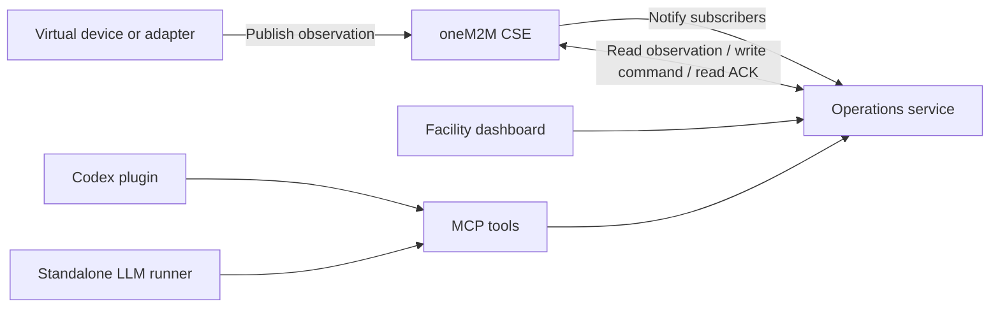

<h1 align="center"></h1>

<p align="center"><strong>Open-source ventilation monitoring and control for multi-zone facilities.</strong></p>

<p align="center">
  <a href="LICENSE"></a>
  <a href="#run-the-local-demo"></a>
  <a href="docs/architecture.md"></a>
</p>

<p align="center">
  <a href="https://github.com/openSoom/openSoom/raw/refs/heads/main/deliverables/video/openSoom-pr-45s.mp4">45-second introduction</a> ·
  <a href="https://github.com/openSoom/openSoom/raw/refs/heads/main/deliverables/video/openSoom-demo-5min.mp4">5-minute demo</a> ·
  <a href="#run-the-local-demo">Quickstart</a> ·
  <a href="CONTRIBUTING.md">Contribute</a> ·
  <a href="docs/project-guide.ko.md">한국어 안내</a>
</p>

A fan can be running while the room still gets too little airflow. openSoom compares each zone with its own target, requests an authorized adjustment, and checks fresh readings after acknowledgement against the facility’s recovery rule. When a device acknowledges the command but airflow stays low, the incident stays open for maintenance.

The dashboard, a Codex plugin and a standalone LLM runner share the same operations service. This hackathon prototype runs a real oneM2M Common Services Entity (CSE) with virtual sensors, dampers and fans. **You can run the demo locally without hardware or a model API key.**


*In this recorded simulation, the learning studio still delivers 200 m³/h against its configured target of 500 m³/h after the damper acknowledges the command.* [Inspect the recorded run](evidence/video/cinematic/dashboard-recordings.json)

## Run the local demo

The verified setup uses macOS on Apple Silicon, Python 3.12.12, Git, uv and OpenSSL. The first run downloads dependencies and uses local ports 8090, 8443 and 8883.

```sh
git clone https://github.com/openSoom/openSoom.git
cd openSoom
uv sync --locked --python 3.12
uv run --no-sync python scripts/cse_bootstrap.py secure
uv run --no-sync opensoom start --secure
uv run --no-sync opensoom doctor
```

Open the [local dashboard](http://127.0.0.1:8090/), choose a facility, and run a scenario. Follow the incident from the first low reading through the command, device acknowledgement and measured outcome. If `doctor` reports `not_ready` during startup, wait a few seconds and run it again.

<details>
<summary>Run the account-free scenario from a terminal</summary>

```sh
uv run --no-sync python -m opensoom.llm_runner --mode fixture --facility food-a --scenario exhaust_fault --expect recovered --prepare-scenario
```

The deterministic runner exercises the shared MCP tools and checks the expected outcome. The food-production scenario above expects airflow to recover. An unresolved scenario passes its own check when openSoom correctly keeps the incident open.

</details>

<details>
<summary>Stop, restart and troubleshoot the demo</summary>

To stop the full local stack after a demo, run these commands from the checkout.

```sh
uv run --no-sync opensoom stop
python3 scripts/cse_runtime.py stop --name secure
python3 scripts/cse_broker.py stop
```

To bring it back, run `python3 scripts/cse_bootstrap.py secure --skip-install`, then `uv run --no-sync opensoom start --secure`. To restart just the application while the CSE is running, use `uv run --no-sync opensoom restart`. Incidents, runs and selected connection settings persist across restart.

For startup failures, check `opensoom doctor`, `.runtime/service.log`, port availability and the named CSE runtime log. Use `uv run --no-sync opensoom cleanup` only when you intend to remove the operational database and scoped credentials. CSE data and the shared model-test budget are retained.

The secure lab profile uses TLS for the CSE and broker. It trusts local clients and binds its listeners to loopback. [Deployment and trust boundaries](deploy/README.md)

</details>

## Why oneM2M is part of the product

School-kitchen inspections illustrate the problem. Yonhap reported that 17.9% of 301 upgraded schools in one ventilation assessment were still rated inadequate. openSoom uses that case to model a reusable operating workflow for food production, learning spaces and other ventilated facilities. Targets, permitted actions and recovery conditions belong to each facility profile. [Reporting](https://www.yna.co.kr/view/AKR20261010032900004) · [Ministry inspection](https://www.moel.go.kr/news/enews/report/enewsView.do?news_seq=18528)

In the independent-app demo, the CSE notifies two applications about the same fault. Each reads the original observation under its own identity. **Operations** can issue a damper command and verify recovery. **Maintenance** creates an inspection order that remains open even after airflow recovers. The CSE enforces their different permissions. [Run the independent applications](docs/multi-application-scenario.md)

| What the facility needs | What oneM2M provides |
| --- | --- |
| Find equipment and compare zones | Resource discovery and native group fan-out through `/fopt/la` |
| Reuse one observation across applications | Subscriptions, a shared content-instance ID and separate application identities |
| Give each application appropriate access | Access Control Policies (ACPs) for observation, command and work-order resources |
| Read the same quantity from different vendors | A discoverable TS-0023 PM2.5 flexContainer exposes readings normalized by openSoom adapters |
| Share selected resources across facilities | MN/IN registration, remote requests and selective announcements |

The local demo works with a single facility. A separate three-CSE test demonstrates local control during a central outage. In another experiment, two same-host CSEs transfer service during planned maintenance and restore a pending command. [Architecture and resource tree](docs/architecture.md) · [Data model](docs/standard-model.md) · [Central outage evidence](evidence/runtime/product-multisite-continuity.json) · [Serving-CSE transfer](docs/handover.md)

<details>
<summary>System diagram</summary>



The protocol tests exercise native MQTT/TLS and HTTPS. The separate maintenance application and its work orders are shown in the [independent-app scenario](docs/multi-application-scenario.md).

</details>

## Use your agent

The Codex plugin guides facility setup and diagnosis. To try it in an isolated Codex profile and verify host calls, run these commands from the prepared checkout.

```sh
uv run --no-sync python scripts/agent_install_plugin.py --install
uv run --no-sync python scripts/agent_codex_check.py
```

For your usual Codex profile, use `uv run --no-sync python scripts/agent_install_plugin.py --install --current-host`. Open a new chat, select openSoom, and ask **“openSoom 가상 시설을 연결하고 현재 상태를 설명해주세요.”** The verified host is the Codex CLI 0.166.0 app-server.

<details>
<summary>Run with a live LLM API</summary>

Set `OPENAI_API_KEY` in your process environment or secret manager and run the example. The live runner uses the configured provider and consumes API usage.

```sh
uv run --no-sync python -m opensoom.llm_runner --mode live --model gpt-5-mini --facility food-a --scenario exhaust_fault --expect recovered --prepare-scenario
```

The model selects tools. The service independently checks authorization, acknowledgement and subsequent observations and retains the run. The guide covers compatible endpoints, negative cases and the persistent request and token allowance. [Agent integration](docs/agent-integration.md) · [Recorded model runs](evidence/agent/index.json)

</details>

## Explore and extend

| If you want to… | Start here |
| --- | --- |
| Add a facility or adapt a vendor's readings | [Extension guide](docs/extending.md) · [Facility profiles](profiles/) · [Adapters](src/opensoom/adapters.py) |
| Follow an observation into a decision | [Operations service](src/opensoom/core.py) · [Control policy](src/opensoom/policy.py) · [Durable state](src/opensoom/store.py) |
| Inspect or extend the integrations | [oneM2M client](src/opensoom/onem2m.py) · [MCP server](src/opensoom/mcp_server.py) · [Codex plugin](plugin/) |
| Reproduce the protocol and failure checks | [Deployment guide](deploy/README.md) · [Runtime evidence](evidence/runtime/) · [Tests](tests/) |
| Present or evaluate the project | [English article prepared for Hackster](docs/submission/hackster-article.md) · [Pitch](pitch/) · [Evaluation Q&A](docs/submission/technical-qa.md) · [Rubric review](docs/hackathon/current-assessment.md) |

The shipped food-production and learning-space profiles share the same application code. Set `OPENSOOM_FACILITY_IDS=food-a` for a food-only instance. Physical equipment and network deployment require site-specific validation. The reported airflow values come from simulated devices. [Technical scope](docs/extension-decisions.md)

The English article is ready for Hackster publication. The repository tracks the public article link and event submission in the [submission handoff](docs/submission/handoff.md).

## Contributing

Facility profiles, vendor adapters, reproducible bug reports and documentation fixes are welcome. In a pull request, describe the facility problem, your change and the observed result. From a prepared checkout, run the test suite with `uv run --no-sync pytest -q`. [Contribution guide](CONTRIBUTING.md)

## License

Source code is licensed under [Apache 2.0](LICENSE). Original documentation, diagrams, logos and media are licensed under [CC BY 4.0](LICENSE-DOCS.md), with attribution to openSoom contributors. [Third-party notices](THIRD_PARTY_NOTICES.md) · [Download the profile logo](docs/assets/opensoom-avatar.png) · [Download the horizontal logo](docs/assets/opensoom-horizontal.png)
