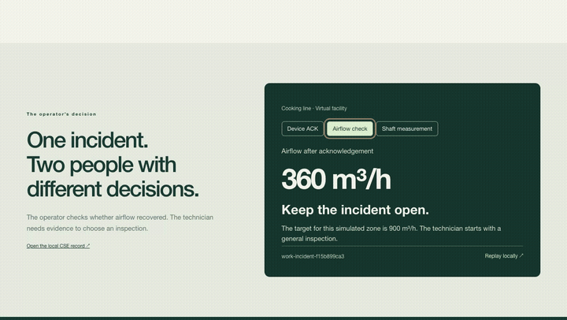
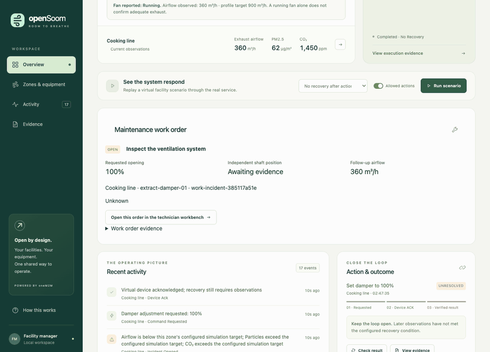
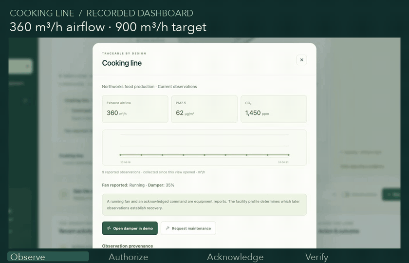
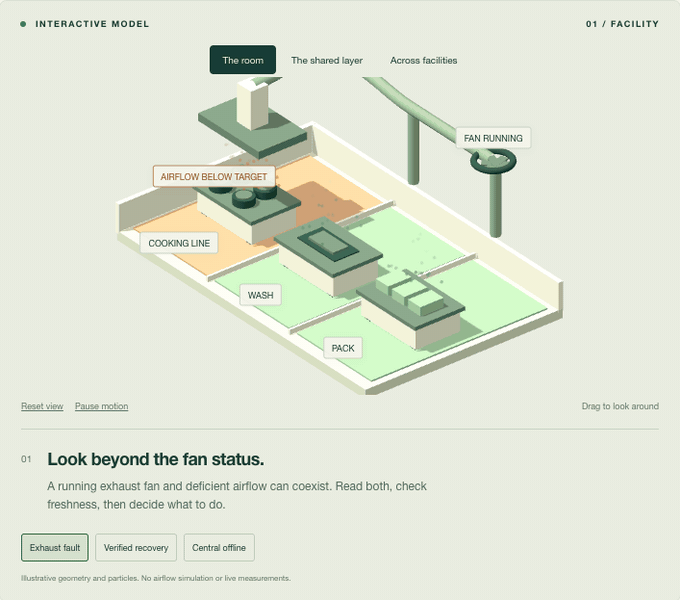
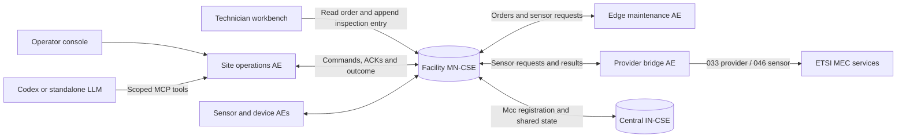

<h1 align="center"></h1>

<p align="center"><strong>Find the first ventilation inspection and verify recovery across shifts.</strong></p>

<p align="center">
  <a href="LICENSE"></a>
  <a href="#run-the-local-demo"></a>
  <a href="docs/architecture.md"></a>
</p>

<p align="center">
  <a href="https://github.com/openSoom/openSoom/raw/refs/heads/main/deliverables/video/openSoom-work-order-720p.mp4">Watch the 720p work-order demo</a> ·
  <a href="https://github.com/openSoom/openSoom/raw/refs/heads/main/deliverables/video/openSoom-demo-5min.mp4">5-minute demo</a> ·
  <a href="#follow-a-ventilation-incident">Workflow</a> ·
  <a href="#why-onem2m-is-part-of-the-product">Architecture</a> ·
  <a href="#run-the-local-demo">Quickstart</a> ·
  <a href="CONTRIBUTING.md">Contribute</a> ·
  <a href="docs/project-guide.ko.md">한국어 안내</a>
</p>

Two ventilation faults can look identical to the operator. In a virtual conservation workshop, two trials both acknowledged **95% opening** and then measured **515 m³/h against a 560 m³/h target**. An independent shaft reading of **35%** sent the technician to the actuator and its position feedback. A reading of **93%** sent the technician to the airflow path. Both incidents stayed open. A competent person still needs to establish the physical cause. [Paired trials and comparison method](docs/inspection-benchmark.md)

| Who uses it | What the application lets them decide |
| --- | --- |
| Facility operator · **Operator console** | Apply an allowed adjustment and check recovery against the facility’s commissioned profile. Open the related order in the technician workbench. |
| Service technician · **Technician workbench** | Select the first inspection, check its source measurements and record a scheduled, performed or escalated inspection against the exact work-order revision. |
| Facility manager · **Codex plugin or independent LLM** | Configure supported facility profiles, author a virtual scenario, run it and read the original oneM2M result. The site administrator activates facility changes. |

Behind those interfaces, the **site operations app** owns control and recovery. The **edge maintenance app** owns the work order. Its **service bridge** gets the independent reading from a local sensor or a commissioned external provider through MEC. All three use separate application identities. [Architecture, placement and permissions](docs/architecture.md)

## Which inspection comes first?

The cooking-line damper acknowledged a 100% opening command. The next simulated airflow reading was **360 m³/h against a 900 m³/h target**. The operator kept the incident open. When an independent shaft sensor measured **35% open**, the technician’s first check changed to actuator travel and position feedback. The work order retained its original ID.

<picture>
  <source media="(prefers-reduced-motion: reduce)" srcset="docs/assets/opensoom-work-order-poster.jpg">
  
</picture>

Two executions exercised the same decision. In the local run, the independent sensor used the facility’s oneM2M service. In the cloud run, a separate bridge discovered an ETSI MEC 046 service and retrieved the other provider’s mapped sensor. Both returned the reading through the MN-CSE to the maintenance app. The site operations app alone controlled the virtual actuator. [Local incident and restart receipts](evidence/runtime/maintenance-release-local.json) · [Cloud service and inspection receipts](evidence/runtime/mec-maintenance-roundtrip.json) · [MEC 033 provider commissioning and subsequent MEC 046 measurement](evidence/runtime/mec-provider-commissioning.json) · [Application responsibilities](docs/mec-application-contract.ko.md)

At a facility whose external provider was still unregistered, the facility owner used oneM2M to commission that provider through MEC 033 and register a MEC 046 sensor subscription. The bridge verified the test callback. A separate 046 lookup supplied the virtual 35% reading. The same subscription survived a bridge restart. [Full commissioning and work-order record](evidence/runtime/option-c/commissioned-sensor-roundtrip.json)

To replay the work order after cloning the repo, run the following from its root. The first two commands install the software. The third launches an isolated lab and keeps its dashboard open. Select **No recovery after action** for a shaft that falls short, or **Low airflow, shaft follows command** for a shaft that reaches the accepted setting. Choose **Run scenario**, wait for the independent measurement, then open the order in the technician workbench. Record **Inspection scheduled** to try the handoff. Press Ctrl+C in the terminal to close both apps and the test CSEs.

```sh
uv sync --locked --python 3.12
uv run --no-sync python scripts/cse_runtime.py install
uv run --no-sync python scripts/maintenance_demo.py --dashboard-port 19490 --technician-port 19492 --hold
```

[Operator console](http://127.0.0.1:19490/) · [Technician workbench](http://127.0.0.1:19492/) · [Agent-authored trials and original CSE observations](evidence/agent/scenario-authoring/README.md)



The same handoff ran on a private cloud lab. The native MEC service returned a virtual shaft reading of 35%, the maintenance worker updated one work-order revision, and the technician app recorded a scheduled inspection. The operator read the same disposition. All six existing command records were preserved and the airflow incident remained open. [Cloud request, work order and technician readback](evidence/runtime/option-c/technician-handoff.json)

In 18 designed virtual trials across two facility profiles, ACK-only, airflow-only and openSoom rules declared false recovery in **14, 2 and 0** of the 16 cases that required further investigation. All three recognized both recoveries. openSoom matched the four prespecified first inspections, two sensor conditions repeated at two sites. These figures describe the designed cases. [Inputs, decision rules and all denominators](docs/inspection-benchmark.md)

## Bring another facility

With the Codex plugin, ask for a preview using your own zones, airflow targets, sensor units and installed adapter. A site administrator activates the reviewed version. One tested example uses a conservation workshop with receiving and bench zones. After restarting the service, the operator replayed its bench trial and read the original measurement; the stale sample produced zero commands. [Configure a site](docs/extending.md) · [Plugin exercise](evidence/agent/facility-onboarding.json) · [Same workers on the new site](evidence/agent/facility-worker-generalization.json)

For an independent sensor provider, the Sandbox can deploy the MN-CSE and maintenance application together. North and south were independently selected logical hosts on one VM. The platform installed both workloads on each host. [Deploy the Option C package](deploy/mec-sandbox/README.md) · [Controller and work-order receipts](evidence/runtime/option-c/index.json)

## Follow a ventilation incident

<picture>
  <source media="(prefers-reduced-motion: reduce)" srcset="docs/assets/opensoom-dashboard-demo-poster.jpg">
  
</picture>

This excerpt follows the landing page’s **Observe → Authorize → Acknowledge → Verify** sequence. The dashboard runs against a real oneM2M CSE with virtual equipment. [Original screen recording](deliverables/video/cinematic/demo/food-session.webm) · [Run and command receipts](evidence/video/cinematic/dashboard-recordings.json)

| What the device reported | What later readings showed |
| --- | --- |
| **Cooking line:** the device acknowledged the damper command | Airflow reached 1,035 m³/h. Two fresh readings verified recovery against the 900 m³/h target. |
| **Learning studio:** the device also acknowledged the command | Airflow stayed at 200 m³/h against the 500 m³/h target. The incident stayed open. [Dashboard screenshot](evidence/dashboard/visual-upgrade-desktop-unresolved.jpg) |

## Why oneM2M is part of the product

School-kitchen inspections illustrate the problem. Yonhap reported that 17.9% of 301 upgraded schools in one ventilation assessment were still rated inadequate. openSoom uses that case to model a reusable operating workflow for food production, learning spaces and other ventilated facilities. Targets, permitted actions and recovery conditions belong to each facility profile. [Reporting](https://www.yna.co.kr/view/AKR20261010032900004) · [Ministry inspection](https://www.moel.go.kr/news/enews/report/enewsView.do?news_seq=18528)

<picture>
  <source media="(prefers-reduced-motion: reduce)" srcset="docs/assets/opensoom-landing-explorer-poster.jpg">
  
</picture>

The landing page's 3D model moves from **the room** to **the shared layer** and then **across facilities**, where the local loop continues during a central disconnection. This animation illustrates the topology. [Launch the interactive landing page locally](pitch/README.md) · [Full architecture view](evidence/pitch/architecture-release-desktop.jpg)

In the independent-app demo, the CSE notifies two applications about the same fault. Each reads the original observation under its own identity. **Operations** can issue a damper command and verify recovery. **Maintenance** creates an inspection order that remains open even after airflow recovers. The CSE enforces their different permissions. [Run the independent applications](docs/multi-application-scenario.md)

| What the facility needs | What oneM2M provides |
| --- | --- |
| Find equipment and compare zones | Resource discovery and native group fan-out through `/fopt/la` |
| Reuse one observation across applications | Subscriptions, a shared content-instance ID and separate application identities |
| Give each application appropriate access | Access Control Policies (ACPs) for observation, command and work-order resources |
| Read the same quantity from different vendors | A discoverable TS-0023 PM2.5 flexContainer exposes readings normalized by openSoom adapters |
| Share selected resources across facilities | MN/IN registration, remote requests and selective announcements |

The local demo works with a single facility. A separate three-CSE test demonstrates local control during a central outage. In another experiment, two same-host CSEs transfer service during planned maintenance and restore a pending command. [Architecture and resource tree](docs/architecture.md) · [Data model](docs/standard-model.md) · [Central outage evidence](evidence/runtime/product-multisite-continuity.json) · [Serving-CSE transfer](docs/handover.md)

<details>
<summary>System diagram</summary>



The protocol tests exercise native MQTT/TLS and HTTPS. For the Option C installation the platform places the MN-CSE and maintenance workload on a selected logical edge. The human workbench reads the facility CSE under its own identity. [Placement evidence](evidence/runtime/option-c/index.json) · [Application boundaries](docs/mec-application-contract.ko.md).

</details>

## Run the local demo

The verified setup uses macOS on Apple Silicon, Python 3.12.12, Git, uv and OpenSSL. The first run downloads dependencies and uses local ports 8090, 8443 and 8883. The demo runs without hardware or a model API key.

```sh
git clone https://github.com/openSoom/openSoom.git
cd openSoom
uv sync --locked --python 3.12
uv run --no-sync python scripts/cse_bootstrap.py secure
uv run --no-sync opensoom start --secure
uv run --no-sync opensoom doctor
```

Open the [local dashboard](http://127.0.0.1:8090/), choose a facility, and run a scenario. Follow the incident from the first low reading through the command, device acknowledgement and measured outcome. If `doctor` reports `not_ready` during startup, wait a few seconds and run it again.

<details>
<summary>Run the account-free scenario from a terminal</summary>

```sh
uv run --no-sync python -m opensoom.llm_runner --mode fixture --facility food-a --scenario exhaust_fault --expect recovered --prepare-scenario
```

The deterministic runner exercises the shared MCP tools and checks the expected outcome. The food-production scenario above expects airflow to recover. An unresolved scenario passes its own check when openSoom correctly keeps the incident open.

</details>

<details>
<summary>Stop, restart and troubleshoot the demo</summary>

To stop the full local stack after a demo, run these commands from the checkout.

```sh
uv run --no-sync opensoom stop
python3 scripts/cse_runtime.py stop --name secure
python3 scripts/cse_broker.py stop
```

To bring it back, run `python3 scripts/cse_bootstrap.py secure --skip-install`, then `uv run --no-sync opensoom start --secure`. To restart just the application while the CSE is running, use `uv run --no-sync opensoom restart`. Incidents, runs and selected connection settings persist across restart.

For startup failures, check `opensoom doctor`, `.runtime/service.log`, port availability and the named CSE runtime log. Use `uv run --no-sync opensoom cleanup` only when you intend to remove the operational database and scoped credentials. CSE data and the shared model-test budget are retained.

The secure lab profile uses TLS for the CSE and broker. It trusts local clients and binds its listeners to loopback. [Deployment and trust boundaries](deploy/README.md)

</details>

## Use your agent

The Codex plugin guides facility setup and diagnosis. To try it in an isolated Codex profile and verify host calls, run these commands from the prepared checkout.

```sh
uv run --no-sync python scripts/agent_install_plugin.py --install
uv run --no-sync python scripts/agent_codex_check.py
```

For your usual Codex profile, use `uv run --no-sync python scripts/agent_install_plugin.py --install --current-host`. Open a new chat, select openSoom, and ask **“openSoom 가상 시설을 연결하고 현재 상태를 설명해주세요.”** The verified host is the Codex CLI 0.166.0 app-server.

<details>
<summary>Run with a live LLM API</summary>

Set `OPENAI_API_KEY` in your process environment or secret manager and run the example. The live runner uses the configured provider and consumes API usage.

```sh
uv run --no-sync python -m opensoom.llm_runner --mode live --model gpt-5-mini --facility food-a --scenario exhaust_fault --expect recovered --prepare-scenario
```

The model selects tools. The service independently checks authorization, acknowledgement and subsequent observations and retains the run. The guide covers compatible endpoints, negative cases and the persistent request and token allowance. [Agent integration](docs/agent-integration.md) · [Recorded model runs](evidence/agent/index.json)

</details>

## Explore and extend

| If you want to… | Start here |
| --- | --- |
| Add a facility or adapt a vendor's readings | [Extension guide](docs/extending.md) · [Facility profiles](profiles/) · [Adapters](src/opensoom/adapters.py) |
| Follow an observation into a decision | [Operations service](src/opensoom/core.py) · [Control policy](src/opensoom/policy.py) · [Durable state](src/opensoom/store.py) |
| Inspect or extend the integrations | [oneM2M client](src/opensoom/onem2m.py) · [MCP server](src/opensoom/mcp_server.py) · [Codex plugin](plugin/) |
| Reproduce the protocol and failure checks | [Deployment guide](deploy/README.md) · [Runtime evidence](evidence/runtime/) · [Tests](tests/) |
| Present or evaluate the project | [English article prepared for Hackster](docs/submission/hackster-article.md) · [Pitch](pitch/) · [Evaluation Q&A](docs/submission/technical-qa.md) · [Release review](docs/review/release-assessment.ko.md) |

The shipped food-production and learning-space profiles share the same application code. Set `OPENSOOM_FACILITY_IDS=food-a` for a food-only instance. Physical equipment and network deployment require site-specific validation. The reported airflow values come from simulated devices. [Technical scope](docs/extension-decisions.md)

The English article is ready for Hackster publication. The repository tracks the public article link and event submission in the [submission handoff](docs/submission/handoff.md).

## Contributing

Facility profiles, vendor adapters, reproducible bug reports and documentation fixes are welcome. In a pull request, describe the facility problem, your change and the observed result. From a prepared checkout, run the test suite with `uv run --no-sync pytest -q`. [Contribution guide](CONTRIBUTING.md)

## License

Source code is licensed under [Apache 2.0](LICENSE). Original documentation, diagrams, logos and media are licensed under [CC BY 4.0](LICENSE-DOCS.md), with attribution to openSoom contributors. [Third-party notices](THIRD_PARTY_NOTICES.md) · [Download the profile logo](docs/assets/opensoom-avatar.png) · [Download the horizontal logo](docs/assets/opensoom-horizontal.png)
