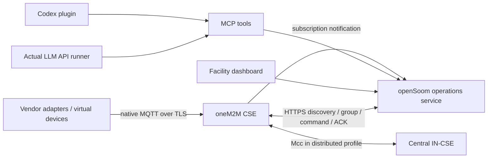

# openSoom

**Open ventilation operations, from evidence to verified action.**

openSoom connects facility observations, diagnosis, authorized actions and outcome checks through oneM2M. A Codex plugin and a standalone LLM API runner use the same tools as the facility dashboard. Food production is the first example. Different facility profiles and device adapters reuse the same core.


**Hackathon prototype:** actual ACME oneM2M CSE, MCP, API and model execution; simulated sensors and actuators. The local runtime and hosted-model recovery, non-recovery and stale-data checks have captured evidence. Independent release review is in progress. Codex **CLI 0.166.0** host integration is tested; a separate desktop UI flow and physical equipment are not verified.

## A concrete operating problem

An installed ventilation system still needs operational verification. Yonhap reported on 11 October 2026 that 17.9% of 301 upgraded school kitchens in the cited performance assessment were rated inadequate. The report motivates checking performance after installation; it does not identify software interoperability as the cause. [Reporting](https://www.yna.co.kr/view/AKR20261010032900004), [official inspection background](https://www.moel.go.kr/news/enews/report/enewsView.do?news_seq=18528).

Our reference scenario is specific: a food-production zone reports a running exhaust fan while its airflow remains below that facility's configured target. openSoom checks data age, identifies the affected zone, requests an authorized damper action, waits for a separate equipment acknowledgement, and checks two later observations. An acknowledged command with continued deficient airflow stays unresolved and calls for maintenance.

School kitchens are one profile. The reusable problem is managing equipment and evidence consistently across food-production and other ventilation-required facilities. Targets remain site-specific. The prototype does not measure pollutant capture or personal exposure and does not establish health benefits or certified ventilation performance.

## Run the local demo

The verified environment is macOS arm64, Python **3.12.12**, `uv`, OpenSSL and Git. Install Python 3.12 and `uv` first. Dependency downloads require Internet access; the deterministic demo needs no paid account, hardware or LLM key. Ports 8090, 8443 and 8883 must be available. Other operating systems need their own acceptance run.

```sh
git clone https://github.com/openSoom/openSoom.git
cd openSoom
uv sync --locked --python 3.12
uv run --no-sync python scripts/cse_bootstrap.py secure
uv run --no-sync opensoom start --secure
uv run --no-sync opensoom doctor
```

Startup is asynchronous. If `doctor` reports `not_ready`, wait a few seconds and run it again. Open **http://127.0.0.1:8090/**. Choose a facility and run a scenario. The dashboard shows freshness, an incident timeline, command state, acknowledgement and observed result. A fixture pass means the expected scenario behavior occurred, including an expected unresolved outcome.

Run the same operations through MCP without a model account:

```sh
uv run --no-sync python -m opensoom.llm_runner --mode fixture --facility food-a --scenario exhaust_fault --expect recovered --prepare-scenario
```

Keep all listeners on loopback. Project-local TLS verifies the CSE and broker servers, but local clients are trusted. See [runtime instructions and trust boundaries](deploy/README.md).

## Use your agent

Prepare an isolated Codex installation and check actual host calls:

```sh
uv run --no-sync python scripts/agent_install_plugin.py --install
uv run --no-sync python scripts/agent_codex_check.py
```

To install into the Codex profile you normally use, run `uv run --no-sync python scripts/agent_install_plugin.py --install --current-host`. In a new Codex chat, select openSoom and ask: **“openSoom 가상 시설을 연결하고 현재 상태를 설명해주세요.”** The setup skill explains prerequisites, facility profiles and permissions. The operations skill reads evidence before action and checks results afterwards. The verified host transport is the CLI app-server; desktop UI selection is not claimed as separately tested.

For an actual model run, supply `OPENAI_API_KEY` through your process environment or secret manager, then:

```sh
uv run --no-sync python -m opensoom.llm_runner --mode live --model gpt-5-mini --facility food-a --scenario exhaust_fault --expect recovered --prepare-scenario
```

The model chooses tool calls. The service independently checks command, ACK and subsequent observations. A failed API call never falls back to a live pass. The [agent guide](docs/agent-integration.md) explains negative cases, supported Responses-compatible endpoints, fixed identities, the shared finite request/token allowance and its persistent accounting. Keys never belong in chat or committed files.

## Why oneM2M is part of the product



| Need | Standard behavior used | Observable evidence |
| --- | --- | --- |
| Applications find new equipment | Native discovery with resource type and facility labels | Discovery responses and request IDs |
| Diagnosis reacts to observations | CSE subscriptions, followed by authoritative reread | Notification and CIN identifiers |
| Operators inspect zones together | Native group `/fopt/la` | Per-member results or preserved native group failure |
| Different actors share data | Distinct AEs and explicit ACPs | Allowed reads and denied unprivileged writes |
| Vendors expose common meaning | Adapter conversion and a TS-0023 PM2.5 flexContainer | Discovered `cod:aiQSr` plus original observations |
| Facilities share selected resources | MN/IN registration, remote requests and announcements | Actual three-CSE continuity demonstration |

A single-vendor isolated installation could use a smaller custom API. oneM2M becomes useful here because separate diagnosis, operations and maintenance identities share the same equipment resources across vendors and facilities. The standard supplies common service behavior; facility-specific diagnosis remains openSoom code. [Architecture and resource tree](docs/architecture.md), [model mapping](docs/standard-model.md).

## Stop, restart and clean up

```sh
uv run --no-sync opensoom restart
uv run --no-sync opensoom stop
uv run --no-sync opensoom start
python3 scripts/cse_runtime.py stop --name secure
python3 scripts/cse_broker.py stop
```

The service retains incidents, runs and selected connection settings across stop/start. Restart the secure CSE/broker with `python3 scripts/cse_bootstrap.py secure --skip-install` before starting the service again.

`uv run --no-sync opensoom cleanup` stops the service and removes its operational database and scoped credentials. It deliberately retains CSE data and the shared model-test budget. Use it only when resetting this project's service state. CSE reset and plugin removal are separate, documented operations; no global trust or unrelated configuration is changed.

If startup fails, inspect `doctor`, `.runtime/service.log` and the named CSE's runtime log. A missing dependency, occupied port or unreachable CSE must be fixed before an operational pass. All runtime state, private keys and generated Codex profiles are ignored by Git.

## Explore and extend

| Path | Responsibility |
| --- | --- |
| `src/opensoom/core.py`, `policy.py`, `store.py` | Operations, profile-bound diagnosis, durable runs/incidents |
| `models.py`, `adapters.py`, `profiles/`, `config/facilities.json` | Contracts, vendor conversions and facility setup |
| `onem2m.py`, `federation.py`, `deploy/` | Native bindings and validated central intents |
| `mcp_server.py`, `llm_runner.py`, `llm_budget.py`, `plugin/` | Shared tools, agent workflows and bounded inference |
| `web/` | Dashboard, original facility visualization and runtime evidence |
| `scripts/`, `tests/`, `evidence/` | Reproduction, failure checks and sanitized observations |
| `docs/submission/`, `deliverables/` | English submission drafts, presentation and video assets |

The [extension guide](docs/extending.md) explains adding a facility or adapter. The two shipped examples use food-production/vendor A and learning-space/vendor B. One facility can run alone with `OPENSOOM_FACILITY_IDS=food-a`. No central topology is required for the local demo.

```sh
uv run --no-sync pytest -q
python3 scripts/cse_bootstrap.py multisite
uv run --no-sync python scripts/cse_product_topology.py
```

The distributed test actually stops the central CSE while a local facility completes a command/ACK/recovery flow. Replayed expired intents are rejected, and duplicate valid intents return the same command. This is a bounded replay demonstration, not an always-running central dispatcher or serving-CSE handover. [Evidence](evidence/runtime/product-multisite-continuity.json).

## Evidence, review and release scope

[Agent evidence index](evidence/agent/index.json) identifies accepted captures and preserves failed attempts. Four independent GPT-6.1 Sol Max teams review all 17 rubric criteria against the same code snapshot. Scores are not official and no total or winning probability is invented. [Stages and gates](docs/implementation-plan.md), [execution checkpoint](docs/execution-state.json), [review ledger](docs/review/review-ledger.json), [Goal prompt](docs/goal-mode-prompt.ko.md).

MEC hosting/services, serving-CSE handover, federated learning and network geolocation have separate [extension decisions](docs/extension-decisions.md). Local CSE processes do not establish those capabilities. Human first-use usability, network deployment and real equipment remain further validation work.

The [English Hackster draft](docs/submission/hackster-article.md) and local media are submission preparation. Public Hackster/video URLs and the eventual article backlink remain pending separate publication. No Discord submission or authentic judge interaction is claimed.

## Licenses and contributions

Project source: [Apache-2.0](LICENSE). Original documentation, diagrams and media: [CC BY 4.0](LICENSE-DOCS.md), attribution to openSoom contributors. Dependencies retain their own licenses: see [third-party notices](THIRD_PARTY_NOTICES.md). Organizer attachments and private runtime material are not redistributed. [Contributing](CONTRIBUTING.md).
