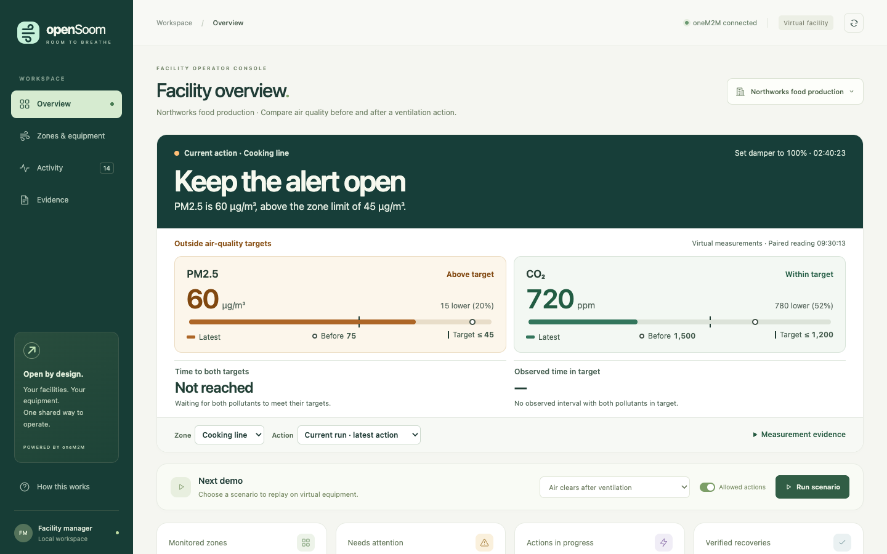
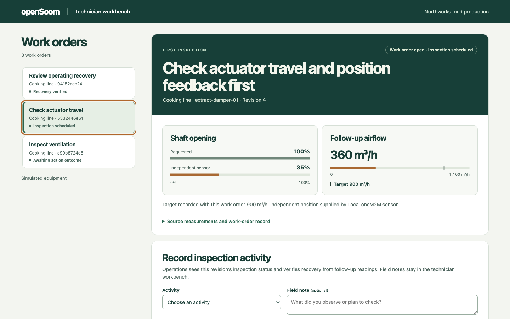
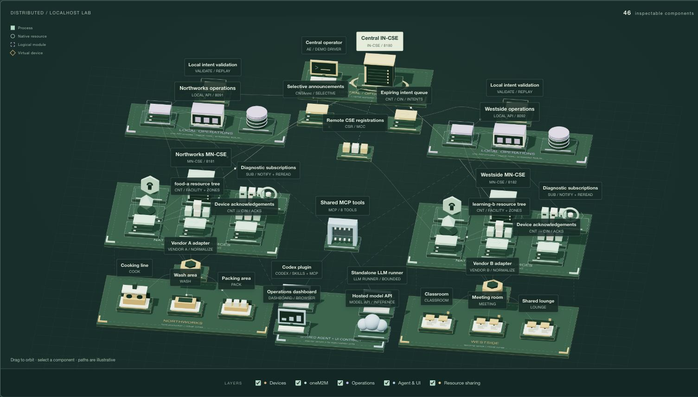

# openSoom — Keep the alert open. Choose the first inspection.

A shift supervisor is about to hand over a room where an air-quality alarm went off. The fan is running and CO₂ has fallen. Can the next shift treat the alert as resolved? In our virtual cooking line, fine particles are still above the facility’s target. Across the maintenance desk, a different incident raises a different question. A damper accepted a fully open command, yet exhaust flow is low. Where should the technician start?

openSoom gives those people separate applications. The operator verifies the air where people work. Maintenance uses independent equipment evidence to choose the first inspection. Both can trace a decision to the same original oneM2M record when their jobs overlap. The film follows two distinct incidents. All device readings are simulated. The local oneM2M and cloud ETSI MEC software ran for real.

[Watch the captioned film](https://github.com/openSoom/openSoom/raw/refs/heads/main/deliverables/video/openSoom-air-quality-720p.mp4) · [Open-source repository and quickstart](https://github.com/openSoom/openSoom)

## Why start with a room?

In November 2025, Korea’s Ministry of Employment and Labor inspected a school kitchen in Seoul and recommended improving its ventilation. The UK Health and Safety Executive also asks commissioning engineers to document the conditions under which a local exhaust system achieves its intended performance. A school kitchen gave us a concrete starting point. A production line, classroom or conservation workshop can bring its own targets, sensors and operating procedures. The thresholds below belong to one virtual zone. [Ministry inspection](https://www.moel.go.kr/news/enews/report/enewsView.do?news_seq=18528) · [HSE commissioning guidance](https://www.hse.gov.uk/lev/commissioning.htm)

## The supervisor keeps the particle alert open

Before the adjustment, PM2.5 was **75 µg/m³** and CO₂ was **1,500 ppm**. After the virtual damper acknowledged the command, airflow reached **1,035 m³/h**. CO₂ fell to **720 ppm**, within the room’s **1,200 ppm** target. PM2.5 fell too, but stopped at **60 µg/m³**, still above **45 µg/m³**. The console shows that the two targets were never reached together. The supervisor leaves the alert open for the incoming shift. This combination of measurements gives no reason on its own to send a technician to inspect the damper shaft. The held console frame and the verification reading taken two seconds later agree on all three measurements for the same command. [Filmed operator incident](https://github.com/openSoom/openSoom/blob/main/evidence/video/role-handoff/operator-incident.json) · [Original pollutant and airflow readings](https://github.com/openSoom/openSoom/blob/main/evidence/video/role-handoff/operator-native-readings.json)



The current dashboard shows the same decision in a separate local replay. Each bar shows the latest reading, with markers for the pre-action value and this zone’s target. The film preserves the interface used during the recorded trials.

The console compares a fresh pre-command reading with readings after the matching device acknowledgement. It measures time to the first sample that meets both targets and how long consecutive samples stay there. A gap ends that observed interval. In a separate recovery trial, both targets were first observed at **6.20 seconds** and held for **10.24 observed seconds** at the time of capture. A third trial reached both and then rebounded. The acquisition clocks measure these accelerated virtual trials. Before field use, each site would need to specify how long readings must stay in range and how large a sampling gap it will accept. The current closure rule counts consecutive fresh samples. A field pilot would need calibrated sensors, site-approved targets and independent exposure measurements to evaluate physical performance. [Timestamped trial evidence](https://github.com/openSoom/openSoom/blob/main/evidence/runtime/air-quality-outcomes.json)

## In a separate low-flow incident, maintenance changes the first inspection

In the cloud case the damper acknowledged **100%** while airflow measured **360 m³/h** against a **900 m³/h** target. Low flow could have several causes. The maintenance app opened a general inspection. At revision 3 of the order, a separate provider’s position measurement was still unavailable.

The MEC service bridge connected to the authorized provider and retrieved **35% shaft opening** from its independent virtual encoder through the ETSI MEC 046 sensor-sharing service. A oneM2M response preserved the sensor identity, unit, measurement time and source. The maintenance app reread it and updated the **same work order to revision 4**. The first inspection became the actuator travel and its position feedback. A technician still has to inspect the equipment to establish the cause.

An automated request to the technician workbench recorded that inspection as scheduled against revision 4. The operator could see the disposition. The incident stayed open. The native command container still held the same six records, with no new equipment command. The cloud demo ran the ACME site node and maintenance software on a one-VM ETSI Sandbox. The film renders the retained cloud response in the technician interface. [Cloud work order, provider response and technician handoff](https://github.com/openSoom/openSoom/blob/main/evidence/runtime/option-c/technician-handoff.json)



In this screenshot the independent sensor belongs to the local facility. The workbench links its scheduled inspection to the exact work-order revision. The cloud case in the film obtained its shaft reading from a separately managed provider through MEC 046. [Dashboard checks and measurement sources](https://github.com/openSoom/openSoom/blob/main/evidence/dashboard/role-dashboard-review.json)

## Why the applications share oneM2M

The **device adapter** writes timestamped observations and acknowledgements. The **site operations app** reads them, applies the facility’s policy and owns permitted equipment commands. The **maintenance app** owns work orders. The **technician app** appends a field entry to the particular revision the technician reviewed. The **service bridge** accesses the external sensor. A technician can record an inspection without acquiring permission to operate the damper. In our access tests the CSE rejected command writes from maintenance, the bridge and the technician. [Access-control results](https://github.com/openSoom/openSoom/blob/main/evidence/runtime/technician-workbench.json)



Each facility’s middle-node CSE stores observations, commands, acknowledgements, outcomes and work orders as identifiable resources. Applications subscribe to changes and reread the original content instance under their own identity. Native group reads help operations query multiple zones. A central infrastructure CSE can access selected shared resources over Mcc. For repeated adapter telemetry the secure profile uses a persistent MQTT/TLS connection. Operations uses HTTPS to request an identified resource or issue a command with an immediate response. One secure product run recorded MQTT observation and acknowledgement writes alongside an HTTPS command. A separate binding test published an observation through MQTT and retrieved its identical oneM2M content-instance ID through HTTPS. Two equipment adapters also expose a discoverable standard TS-0023 PM2.5 sensor. The application preserves CO₂ separately in ppm. [Resource design](https://github.com/openSoom/openSoom/blob/main/docs/architecture.md) · [Secure product run](https://github.com/openSoom/openSoom/blob/main/evidence/application/release-acceptance.json) · [Binding test](https://github.com/openSoom/openSoom/blob/main/evidence/runtime/cse-mqtt-tls-smoke.json) · [Standard data mapping](https://github.com/openSoom/openSoom/blob/main/docs/standard-model.md)

The open-source ACME implementation makes the same standard resources available to both applications. [oneM2M service-layer overview](https://www.onem2m.org/using-onem2m/what-is-onem2m) · [ACME oneM2M CSE](https://github.com/ankraft/ACME-oneM2M-CSE)

A site that already owns a trustworthy position sensor can use it locally. Where a separate provider operates the sensor, the bridge uses the MEC registry, provider enrolment and sensor-sharing APIs. Operations can keep its existing control policy when the provider changes. This is why the cloud maintenance route is optional in a single-facility installation. [Deployment choices and application contract](https://github.com/openSoom/openSoom/blob/main/docs/mec-application-contract.ko.md)

## Run it and try another facility

The local demonstration uses a computer, Python 3.12, uv, Git and OpenSSL. We tested it on macOS. The sensors for fine particles, CO₂, airflow and shaft position, as well as the controllable damper, are virtual. The deterministic demonstration needs no hardware purchase or paid model account.

```sh
git clone https://github.com/openSoom/openSoom.git
cd openSoom
uv sync --locked --python 3.12
uv run --no-sync python scripts/cse_runtime.py install
uv run --no-sync python scripts/maintenance_demo.py --dashboard-port 19490 --technician-port 19492 --hold --opening-scenario air_quality_persistent
```

Open the operator console at `http://127.0.0.1:19490/` for the persistent-particles trial. Try **Air clears after ventilation** and **Particles return** for comparison. The workbench at `http://127.0.0.1:19492/` contains a separate seeded local low-flow case. A trustworthy local virtual sensor supplies that replay. The linked cloud record preserves the external MEC path shown in the film. Press Ctrl+C in the launcher terminal to stop the local lab.

A facility manager can use the Codex plugin to draft zones, targets and equipment bindings. A facility administrator activates an approved profile. A standalone runner can call a real hosted language model through the same tools. In a learning-space test the model saved and ran a new stale-reading scenario and retrieved the original CSE evidence. The service issued zero new commands. In a configured conservation workshop the same maintenance code handled a different zone target and asset. These software trials establish reuse across profiles. Unassisted first use and real-site performance remain field tests. [Codex and hosted-model runs](https://github.com/openSoom/openSoom/tree/main/evidence/agent/scenario-authoring) · [Second facility and adapter guide](https://github.com/openSoom/openSoom/blob/main/docs/extending.md)

Across 18 designed cases at two virtual facilities, 16 required the alert to remain open. An acknowledgement-only rule closed 14 of those in error. An airflow-only rule closed two. openSoom kept all 16 open. The cases and decision rules are public, so another facility can challenge the result with its own examples. [Comparison and original records](https://github.com/openSoom/openSoom/blob/main/docs/inspection-benchmark.md)

Source code is Apache-2.0. Original documentation and media are CC BY 4.0. [Source and contribution guide](https://github.com/openSoom/openSoom) · [Licenses and third-party notices](https://github.com/openSoom/openSoom/blob/main/THIRD_PARTY_NOTICES.md)
