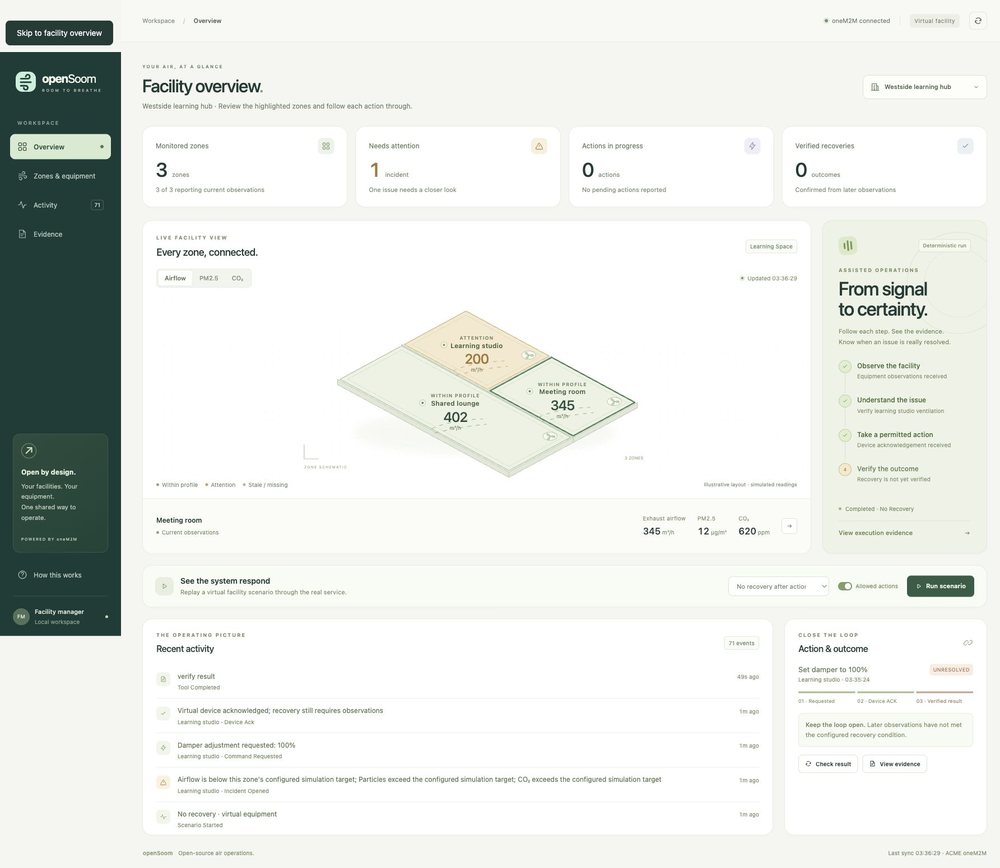
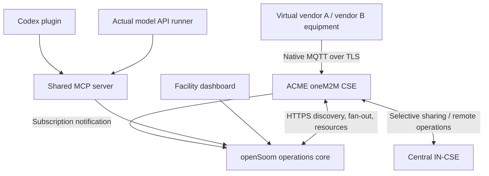

# openSoom: verify ventilation actions across facilities and vendors

**Publication state: draft, not posted.** Repository: [openSoom/openSoom](https://github.com/openSoom/openSoom). Video: local deliverable in `deliverables/video/`; public hosting URL pending. Interactive presentation: `pitch/index.html`. Replace these handoff notes only after publication and logged-out access checks.

## The problem starts after installation

On 11 October 2026, Yonhap reported that 17.9% of 301 upgraded school kitchens in the cited ventilation performance assessment were still rated inadequate. This motivates a concrete question: after installing or operating equipment, how does a facility manager know whether the intended condition was achieved? The reporting does not establish vendor integration as a cause. [Source reporting](https://www.yna.co.kr/view/AKR20261010032900004), [official inspection background](https://www.moel.go.kr/news/enews/report/enewsView.do?news_seq=18528).

Our example is a food-production line with cooking, washing and packing zones. A fan can report running while the observed exhaust flow is below that zone's configured target. A manager needs current observations, an authorized response, a distinct equipment acknowledgement and subsequent observations. Simply sending “open the damper” is insufficient evidence of recovery.

School kitchens motivated the reference case. The product scope is wider: food production and other facilities that need consistent ventilation operations across equipment suppliers and sites. Consistency means common data meaning, roles and workflows. It does not mean a universal airflow or pollution threshold.

## What we built

openSoom is an open-source operations service with a facility dashboard, Codex plugin and standalone LLM API runner. Its eight MCP tools inspect readiness, prepare/apply authorized configuration, discover resources, read groups and evidence, request actions and verify outcomes. The service stores incidents and runs so a chat or process restart does not erase operating context.

The physical equipment is virtual. Actual software executes the oneM2M CSE, native protocol operations, access policies, MCP host calls and hosted model inference. All displayed measurements and actuator behavior are simulated. The project does not establish certified ventilation performance, capture efficiency, personal-exposure reduction or clinical benefit.



## Why oneM2M fits this problem

A single vendor could provide its own dashboard and API. Our goal is to let diagnosis, operations and maintenance use the same resources across vendors and facilities. oneM2M provides shared discovery, subscriptions, groups, access control and distributed resource operations. A replacement adapter changes wire-format translation while the operating workflow stays the same.

The diagnostic, operator, maintenance and adapter roles use distinct application entities. A restricted observer demonstrates scoped read access. The small local runtime cohosts these logical responsibilities; the distributed demonstration additionally runs separate facility APIs and CSEs.



The CSE resource tree contains facility/zone containers with observation, command and ACK content instances. Native subscriptions notify the service of new observations. A facility group fans out across its observation containers. Separate ACPs govern structure, observations, commands and ACKs. Standard PM2.5 flexContainers sit beneath the application AE. [Full resource tree](../architecture.md).

## Data models and protocols

Vendor A uses µg/m³ for PM2.5, m³/h for airflow, a boolean fan report and percentage damper position. Vendor B uses mg/m³, litres/second, RUN/STOP and a fractional valve value. The adapter normalizes both into the same observation contract and preserves missing values and timestamps.

A useful subset of the oneM2M TS-0023 v5.6.0 airQualitySensor model exposes PM2.5 through actual `cod:aiQSr` flexContainers. Native discovery finds them, and the evidence tool reads them. The SDT integer projection rounds PM2.5 while the original observation retains precision. CO₂ stays in the canonical ppm field because the standard model's CO₂ property uses mass concentration. We also avoid mapping measured volume flow to the standard airFlow speed level. [Model mapping and specification](../standard-model.md).

Virtual equipment publishes native oneM2M request primitives over MQTT/TLS; this is not an MQTT-to-HTTP bridge. Operator/service CSE operations use HTTPS. The lab CA is project-local and clients verify it. The API and subscription callback are loopback HTTP, and the distributed CSE profile uses HTTP. Local origin headers and anonymous lab MQTT clients are trusted; production device identity and network hardening are outside the verified prototype.

## One recoverable incident, one honest failure

In the reference scenario the virtual fan runs, but cooking-zone airflow is deficient. The model reads evidence, requests a bounded damper adjustment and polls `verify_result`. The adapter first reads the actual CSE command and writes an ACK. Two distinct healthy observations after that ACK allow the service to report recovery.

The accepted hosted recovery capture is `agent-379720ef883c`. It contains actual gpt-5-mini function calls through MCP and service-checked outcomes. The corresponding no-recovery capture, `agent-479f866b7e84`, receives an ACK but observes two later deficient samples. The model's report remains unresolved. In `agent-7a56497c01be`, stale evidence causes control refusal and no command is created. [Evidence index](../../evidence/agent/index.json).

A deterministic fixture exercises the same actual MCP/CSE path without a model account and receives a distinct `PASS_FIXTURE` label. A test pass in an expected-negative case means the refusal or unresolved state was handled correctly, not that the facility recovered.

Testing exposed a real defect: a reused request ID could retrieve an old successful command. We bound idempotency and verification to the current run, and removed historical commands from current-run evidence. The retained failed attempt explains the correction; accepted evidence identifies the later secure runs. Server-recorded operations, ACK and observations decide a pass, not model prose alone.

## Local control during a central outage

The distributed test runs a central IN-CSE and two facility MN-CSEs as separate local processes. Native registration, remote discovery/retrieval and selective announcements share resources. When the test stops the central CSE, the food facility continues its observation, action, ACK and recovery loop locally.

After reconnection, a delayed expired central intent is rejected without changing commands or incident state. A profile-mismatched intent is also rejected. A valid intent for the other facility passes the local policy and produces one command; replay returns that command. The central identity cannot bypass the facility policy by directly writing its command container. [Reproducible continuity evidence](../../evidence/runtime/product-multisite-continuity.json).

This test demonstrates bounded outage continuity and explicit replay. It is not serving-CSE handover, an always-running central dispatcher, VM migration or ETSI MEC deployment. Those capabilities need their own product need, environment and evidence. [Extension decisions](../extension-decisions.md).

## Install and try it

The supported rehearsal environment is macOS arm64 with Python 3.12.12, uv, OpenSSL and Git. The CSE is ACME 2026.5.3 in a separate pinned environment. Initial dependency installation needs network access. No hardware, Docker daemon or model account is required for the fixture.

```sh
git clone https://github.com/openSoom/openSoom.git
cd openSoom
uv sync --locked --python 3.12
uv run --no-sync python scripts/cse_bootstrap.py secure
uv run --no-sync opensoom start --secure
uv run --no-sync opensoom doctor
uv run --no-sync python -m opensoom.llm_runner --mode fixture --facility food-a --scenario exhaust_fault --expect recovered --prepare-scenario
```

Open the local dashboard at http://127.0.0.1:8090/. The README covers readiness, stop/restart/cleanup and ports. The [agent guide](../agent-integration.md) covers Codex plugin installation and actual API mode. Codex CLI 0.166.0 was tested through a fresh app-server host profile; a separate desktop UI rehearsal and human first-use study remain future validation.

## Open-source reuse

The facility registry chooses profile, adapter and read-only access. Profile JSON contains zone targets and recovery rules. A new facility can reuse an existing profile and adapter without editing the core. A new vendor mapping needs focused conversion and failure tests, not rewritten agent tools. The code, configuration and evidence are organized for this contribution path. [Extension guide](../extending.md).

The source is Apache-2.0. Original documentation and media are CC BY 4.0. ACME, aMQTT, Three.js and other dependencies retain their licenses. Organizer documents and private runtime material are excluded.

## What remains

We have not tested real physical ventilation, production network authentication, another agent host, a desktop installation wizard, managed MEC deployment, federated learning or network location services. The architecture deliberately keeps those claims separate from the actual local and distributed demonstrations. A next useful pilot would validate a real read-only adapter and site-specific observations before enabling any physical control.

Public article/video hosting and team-channel submission remain handoff actions. No fabricated public discussion, customer endorsement or judge outcome is included. The repository's independent review ledger tracks all 17 official rubric criteria without inventing weights or an aggregate official score.
