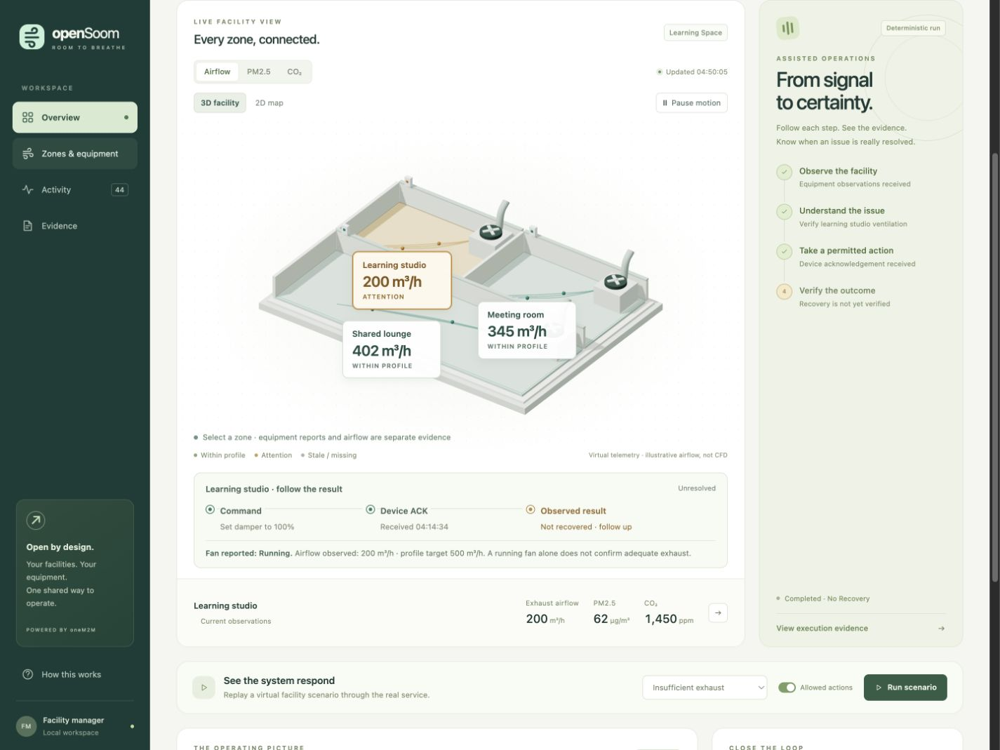

# openSoom: Verify Ventilation Across Facilities and Vendors

A fan reports **running**. Its damper reports **100% open**. The room still has an unresolved airflow problem.

openSoom connects those observations to an operating decision and checks what happened afterwards. It combines oneM2M equipment resources, facility-specific rules, a visual dashboard and AI-agent tools so a manager can follow a problem from fresh evidence to an authorized action, a separate device acknowledgement and a verified result.

**This is a working software demonstration with virtual physical equipment.** The CSE, protocol operations, access checks, MCP calls and recorded model inference actually execute. Sensor readings, fan/damper behavior and recovery values are simulated. The project demonstrates integration and operational verification; it does not certify ventilation performance or establish a health benefit.



*A recorded application screen, not a rendered physical experiment: the learning studio reports 200 m³/h against its configured simulation target of 500 m³/h. Command, device ACK and observed result remain separate.*

[Source and quickstart](https://github.com/openSoom/openSoom) · [45-second introduction — MP4](https://github.com/openSoom/openSoom/raw/refs/heads/main/deliverables/video/openSoom-pr-45s.mp4) · [Full narrated demonstration — MP4](https://github.com/openSoom/openSoom/raw/refs/heads/main/deliverables/video/openSoom-demo-5min.mp4)

## The problem continues after installation

The reference case comes from school kitchens. In November 2025, South Korea's Ministry of Employment and Labor inspected school-kitchen ventilation and recommended correcting insufficient performance so cooking emissions could be exhausted. In October 2026, Yonhap reported that 17.9% of 301 upgraded schools in the cited performance assessment were still rated inadequate. That is the assessed sample, not an estimate for every school. [Ministry inspection report](https://www.moel.go.kr/news/enews/report/enewsView.do?news_seq=18528), [Yonhap reporting](https://www.yna.co.kr/view/AKR20261010032900004).

These sources motivate checking operation after an upgrade. They do not establish that vendor interfaces caused the deficiencies, or that software alone can fix hood or duct design.

The product question is narrower and testable: **can different users connect equipment state, relevant observations, data age, an allowed response and the evidence after that response?** A running fan is one observation. The command sent to it, the reported device state and measured exhaust performance are different observations.

School kitchens are an example, not a restriction. The same operating pattern applies to food-production areas and other facilities with ventilation requirements. Each facility supplies its own equipment relationships, targets, permitted actions and recovery conditions.

## Two use cases, one operations core

### 1. Recover an allowed operating condition in food production

The virtual food-production facility has cooking, washing and packing zones. In the cooking zone, the fan is running but airflow is **360 m³/h** against that profile's **900 m³/h** target. The damper reports 35%. The service checks observation age and opens an incident.

In the recorded hosted-model run, the model discovers the facility, reads evidence and requests the permitted damper setting of 100%. The service validates the request and writes a command to the real CSE. The virtual adapter reads that command and writes a separate ACK. The first verification is still pending; only later observations can complete it.

Two distinct healthy observations after the ACK establish the simulated recovery. In this run, reported airflow becomes **1,035 m³/h**. This value comes from a deterministic virtual-device scenario, not a measured improvement in a physical kitchen. [Actual model/tool/CSE record: `agent-43ac7ce3f8d7`](https://github.com/openSoom/openSoom/blob/main/evidence/agent/release-live-recovery.json).

### 2. Keep a learning-space fault open after an acknowledgement

The second facility uses a different profile and vendor format. Its learning studio reports **200 m³/h** against a **500 m³/h** simulation target; the meeting room and lounge are within their own configured targets.

Here the damper command is acknowledged and the damper reports 100%, but subsequent airflow remains deficient. The command's observed result stays **unresolved**. The incident remains available for maintenance follow-through rather than disappearing when a device answers.

The historical learning-space captures retain the earlier acknowledged command even when the observer conversation has an empty command list. A zero recovery-sample counter does not mean that nobody tried a repair. The counter measures consecutive qualifying observations after an ACK; command history has its own declared run scope. These are attributed records of their original runs, not current measurements or command history for a newly started run. [Actual application scenarios](https://github.com/openSoom/openSoom/blob/main/evidence/application/release-acceptance.json), [historical learning-space capture](https://github.com/openSoom/openSoom/blob/main/evidence/agent/semantics-mcp-capture.json), [completed Codex interpretation](https://github.com/openSoom/openSoom/blob/main/evidence/agent/units-live.json). The film's newly recorded dashboard sessions have their own [run and command evidence](https://github.com/openSoom/openSoom/blob/main/evidence/video/cinematic/dashboard-recordings.json).

The profiles change targets and permitted behavior; the adapters change wire-format translation. The diagnosis and agent-tool code stay the same.

## Why oneM2M belongs in the design

A single supplier could provide a device API and its own dashboard. openSoom addresses the next integration problem: diagnosis, operations and maintenance need to reuse equipment evidence across vendors and facilities.

oneM2M supplies a shared service layer with resources and common operations. MQTT can carry its traffic; adopting oneM2M is not a claim that MQTT is unsuitable. The benefit is a common resource, discovery, notification and access contract above the transport. [oneM2M's service-layer rationale](https://www.onem2m.org/using-onem2m/what-is-onem2m), [developer resources](https://www.onem2m.org/using-onem2m/developers).

| Operating need | Actual oneM2M behavior | What openSoom still implements |
| --- | --- | --- |
| Find accessible equipment | Native discovery queries, resource types and facility labels | Facility/profile selection and adapter mapping |
| React to a new observation | CSE subscriptions and notifications | Authoritative reread, freshness checks and diagnosis |
| Inspect several zones | Native group `/fopt/la` retrieval | Presenting per-member results and explicit failures |
| Separate authority | Distinct AE registrations and scoped ACPs | Fixed service identities, profile permissions and tool validation |
| Share selected resources between sites | MN/IN registration, remote access and selective announcements | Expiring central intents, local validation and explicit replay |

The group is used to retrieve observations. A successful fan-out response proves CSE operations, not that actuators executed a command. When the pinned CSE returns a failed aggregate, openSoom retains that native error and labels any separate diagnostic reads. [Native binding and common-service evidence](https://github.com/openSoom/openSoom/tree/main/evidence/runtime).

## One observation, two independent applications

Operations needs to restore a permitted condition. Maintenance needs an inspection record that survives a temporary recovery. Those responsibilities need different outputs and permissions, while referring to the same equipment event.

A supplementary scenario runs operations, maintenance and the virtual device as **three separate processes with distinct registered AEs** against a real CSE. Two native subscriptions deliver the same cooking-line fault to the two consumers. Each independently retrieves that exact content instance using its own origin and request ID; neither application calls the other.

Operations retrieves multi-zone context through native group fan-out, sends one expiring damper command and checks ACK plus later observations. Maintenance creates a correlated inspection work order. Its attempted command write is actually rejected by the CSE with `4103`.

| Simulated device case | Operations result | Maintenance result |
| --- | --- | --- |
| Later observations recover | Verified recovery | Observations recovered; inspection still pending |
| Device sends no ACK | ACK timeout | Inspection required |
| Device ACKs, but airflow stays deficient | Unresolved after ACK | Inspection required |

The film's original retained run is `ma-d1a54f066e`; its observations and identifiers are preserved. The current worker source was separately revalidated in `ma-b9129cb90a`, repeating all three cases. This isolated HTTP-loopback example trusts asserted local AE identities and uses virtual equipment. It is separate from the dashboard and LLM runner; those interfaces do not orchestrate these workers. [Original execution index and traces](https://github.com/openSoom/openSoom/tree/main/evidence/runtime/multiapp), [current-source revalidation](https://github.com/openSoom/openSoom/blob/main/evidence/runtime/multiapp-revalidation/index.json), [scenario and permission guide](https://github.com/openSoom/openSoom/blob/main/docs/multi-application-scenario.md).

After preparing the pinned environment described below, reproduce it without overwriting the retained evidence:

```sh
.venv/bin/python scripts/cse_multiapp_smoke.py --evidence tmp/multiapp-reproduction
```

## Read the architecture in layers


*An explanatory Three.js view of the distributed lab. Some cards represent processes; others represent native resources or logical modules. The component count is not a process count. Geometry and animated paths are illustrative.*

The default installation runs one operations service and a real **ACME CSE 2026.5.3**. It supports both example facilities without requiring the distributed topology. Logical roles have separate oneM2M AE identities even where their implementation is cohosted.

| Part | What runs in this prototype |
| --- | --- |
| Physical equipment | Virtual fans, dampers and airflow/PM2.5/CO₂ observations; no physical sensor or actuator is required |
| Common service layer | Actual pinned ACME oneM2M CSE processes and protocol bindings |
| Operations | Actual API, profile-bound diagnosis, incident/command verification and persistent SQLite state |
| Agent clients | Actual MCP server, tested Codex CLI plugin and standalone model API runner |
| Visuals | Browser dashboard and an explanatory Three.js pitch; geometry is not an airflow model |

The resource model is deliberately small:

```text
opensoom AE
├── facility ACPs: structure / observations / commands / ACKs
├── facilities
│   ├── food-a / cook, wash, pack
│   │   └── each zone: observations, commands, ACKs
│   └── learning-b / classroom, meeting, lounge
├── facility observation groups
└── standard PM2.5 flexContainers
```

Observation, command and ACK containers hold content instances. Each observation container has a subscription. Protected containers have explicit ACP references; administrators provision resources, while normal operations use scoped AE origins. [Detailed resource tree and responsibilities](https://github.com/openSoom/openSoom/blob/main/docs/architecture.md).

The secure single-installation profile uses **native oneM2M MQTT/TLS** for adapter observations, ACKs and standard-model updates. Service reads and command writes use **HTTPS**. MCP uses stdio; the local API and notification callback use loopback HTTP.

The distributed demonstration is a separate HTTP lab: two facility APIs, two MN-CSEs and a central IN-CSE run as independent local processes. It does not inherit the secure profile's TLS claim. [Deployment profiles and trust boundaries](https://github.com/openSoom/openSoom/blob/main/deploy/README.md).

## Preserve meaning when replacing a vendor

The two virtual vendors intentionally disagree about data representation:

| Measurement or state | Vendor A | Vendor B | Common contract |
| --- | --- | --- | --- |
| PM2.5 | µg/m³ | mg/m³ | µg/m³ |
| Airflow | m³/h | litres/second | m³/h |
| Fan report | Boolean | `RUN` / `STOP` | Boolean |
| Damper position | Percentage | Fraction from 0 to 1 | Percentage |

Adapters preserve missing values and observed/received timestamps. A new vendor needs a mapping and focused conversion/failure checks; it should not need rewritten diagnosis or MCP tools. A third virtual facility can reuse an existing profile and adapter through configuration. [Add a facility or adapter](https://github.com/openSoom/openSoom/blob/main/docs/extending.md).

For a standard projection, the CSE exposes and discovers actual `cod:aiQSr` flexContainers. The application reads their PM2.5 property. The pinned **TS-0023 v5.6.0** model defines `pm25` as an integer in µg/m³, so the projection rounds while canonical observations retain precision. Its CO₂ field uses mg/m³; openSoom keeps its ppm reading in the canonical observation instead of assigning an incompatible value. [Official airQualitySensor definition](https://specifications.onem2m.org/ts/ts-0023/v5.6.0/5.3/#5316-airqualitysensor), [implemented mapping and validation](https://github.com/openSoom/openSoom/blob/main/docs/standard-model.md).

## Let an agent operate through the same boundary

The Codex plugin packages setup and operations skills with an MCP connection. Its eight tools are `doctor`, `prepare_setup`, `apply_setup`, `discover`, `read_group`, `read_evidence`, `request_action` and `verify_result`. The standalone model API runner uses the same MCP/service path as the plugin.

The service owns durable runs and incidents. It validates role, facility, profile, freshness, action bounds, expiry and idempotency. The operational model cannot grant itself administrator access or activate an unapproved profile. A service restart or a new conversation does not turn an old successful command into evidence for a new incident.

Actual Codex CLI **0.166.0** rehearsals cover fresh-profile plugin registration, real host MCP calls and model-selected setup/diagnostic tools. A separate completed Codex turn explains attributed recorded results with their units and history. These components were checked separately; they are not presented as one uninterrupted conversation or a desktop installation study. Hosted-model runs also demonstrate recovery and an actual stale-control denial. The stale case shows the service rejecting a model's premature request, not a claim that the model always plans correctly. [Agent execution index](https://github.com/openSoom/openSoom/blob/main/evidence/agent/index.json), [setup and model guide](https://github.com/openSoom/openSoom/blob/main/docs/agent-integration.md).

## Run both cases without hardware or a paid model account

The verified source-checkout environment is macOS arm64, Python **3.12.12**, `uv`, OpenSSL and Git. Other operating systems need their own acceptance run. Initial dependency downloads require Internet access. The deterministic scenarios require no hardware or model API key; ports **8090**, **8443** and **8883** must be free.

```sh
git clone https://github.com/openSoom/openSoom.git
cd openSoom
uv sync --locked --python 3.12
uv run --no-sync python scripts/cse_bootstrap.py secure
uv run --no-sync opensoom start --secure
uv run --no-sync opensoom doctor
```

Startup is asynchronous. Wait for `doctor` to report readiness, then open **http://127.0.0.1:8090/**. Run the food-production recovery through actual MCP and CSE software:

```sh
uv run --no-sync python -m opensoom.llm_runner \
  --mode fixture --facility food-a --scenario exhaust_fault \
  --expect recovered --prepare-scenario
```

Then run the learning-space case in which an ACK does not establish recovery:

```sh
uv run --no-sync python -m opensoom.llm_runner \
  --mode fixture --facility learning-b --scenario no_recovery \
  --expect unresolved --prepare-scenario
```

`PASS_FIXTURE` means the expected scenario behavior was observed. In the second command, the expected result is an unresolved incident. It is never evidence that a live model ran or that the facility recovered.

To connect the plugin to a Codex profile, follow the public agent guide. The installer also supports a separate isolated profile for verification. For a real model run, provide an API key through the process environment or a secret manager and select `--mode live`; do not paste secrets into chat. All live attempts share persistent finite request/token accounting, including failed attempts and restarts.

Stop the service with `uv run --no-sync opensoom stop`; `start` and `restart` retain selected connection settings and operating state. The documented `cleanup` removes scoped service state while preserving CSE data and the model-test allowance. Clean-environment checks also preserve a pending incident across restart and let an unacknowledged command time out without inventing recovery. [Reproducible lifecycle record](https://github.com/openSoom/openSoom/blob/main/evidence/release/final-clean-lifecycle.json).

## Keep local operation independent of the central connection

The distributed test stops the central IN-CSE while a facility completes its local observation → command → ACK → recovery path. After reconnection, the facility rejects an expired central intent and a mismatched profile, then handles a valid intent through its local policy. Repeating that valid intent returns the same command.

Selective announcements are not whole-state replication. The demonstrated replay is explicit, not an always-running central dispatcher. This is local continuity during a central outage; it is not serving-CSE handover, process migration or ETSI MEC deployment. [Actual distributed continuity record](https://github.com/openSoom/openSoom/blob/main/evidence/runtime/product-multisite-continuity.json).

An optional, separate maintenance lab (`handover-b6e82ef69f`) automatically switches the logical facility endpoint from CSE A to an independent CSE B after two failed transport probes. It restores the last observation, open incident, profile version and pending command identity/expiry, rebuilds native subscriptions and scoped ACPs, and rejects stale-source commands. The virtual device records one applied effect despite replay. This application-managed transition uses two same-host HTTP CSEs and a shared local authority database; CSE-local AEs are re-registered. It is separate from the film's central-outage experiment and does not establish native AE-ID mobility, node-failure HA or MEC deployment. [Maintenance lab](https://github.com/openSoom/openSoom/blob/main/docs/handover.md), [captured execution and receipts](https://github.com/openSoom/openSoom/blob/main/evidence/runtime/handover/handover-b6e82ef69f.json).

## What testing changed

The most useful results were the distinctions the system had to preserve:

- **A request ID needs context.** Reusing an earlier successful command once made a later incident look recovered. Idempotency and verification now bind the action to its run and incident.
- **An acknowledgement is only one event.** A separate non-recovery case keeps an acknowledged command unresolved when later observations remain deficient.
- **History has a scope.** A conversation's empty command list cannot erase an earlier intervention. The tools expose their history limits and the meaning of recovery-sample counters.
- **Units travel with values.** A validation projection that stripped units caused a model to invent L/min. The retained failed answer led to a measurement-complete input check and a corrected grounded response.

The repository preserves failed captures beside the accepted evidence. Request IDs, command IDs, ACKs and later observations are the acceptance evidence; fluent model prose is checked against them. [Review ledger](https://github.com/openSoom/openSoom/blob/main/docs/review/review-ledger.json).

## Reuse the system, validate the facility

The next adoption step is a real read-only device adapter and a facility-specific commissioning process. Physical controls should remain disabled until equipment identity, relevant measurements, authority and permitted behavior have been validated. PM2.5 and CO₂ alone do not establish capture adequacy or exposure protection.

The local lab verifies server-authenticated HTTPS/MQTT TLS and scoped ACP behavior. It trusts local clients: origin headers are not cryptographic device identities and the lab broker is anonymous on loopback. Production network authentication, real equipment, other hosts and conditional MEC/mobility/learning extensions need their own evidence. [Current boundaries and extension decisions](https://github.com/openSoom/openSoom/blob/main/docs/extension-decisions.md).

Project source is **Apache-2.0**. Original documentation, diagrams and media are **CC BY 4.0**. Third-party dependencies keep their own licenses; organizer documents, system fonts and voice models are not redistributed. [Source license](https://github.com/openSoom/openSoom/blob/main/LICENSE), [documentation license](https://github.com/openSoom/openSoom/blob/main/LICENSE-DOCS.md), [third-party notices](https://github.com/openSoom/openSoom/blob/main/THIRD_PARTY_NOTICES.md).

**Connect the equipment. Inspect the evidence. Verify what changed.** [Build or contribute to openSoom](https://github.com/openSoom/openSoom).
