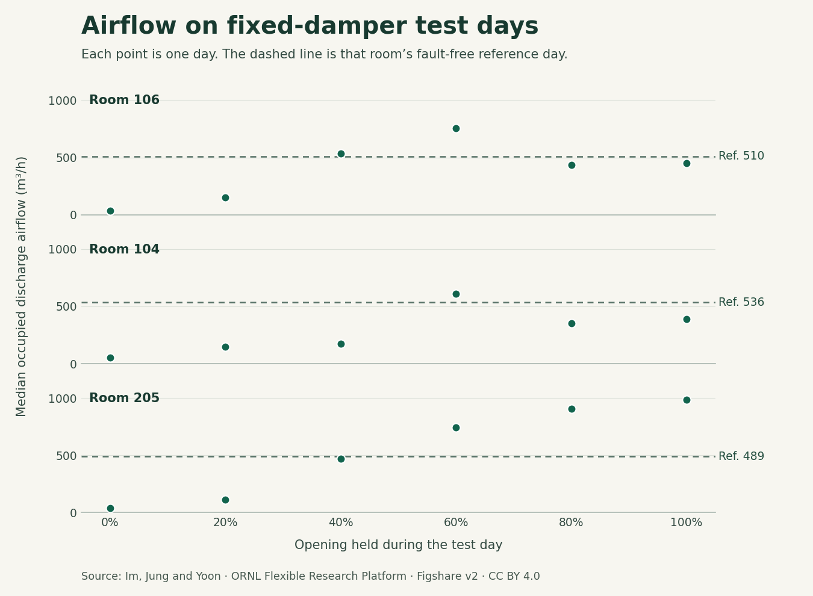

# Check a building's recorded airflow before connecting controls

The Oak Ridge National Laboratory Flexible Research Platform is a two-story test building. Its researchers ran controlled experiments in three rooms, holding dampers at specific openings or introducing a bias in the discharge-airflow sensor. The five published workbooks contain a minute-by-minute comparison between normal operation and the imposed faults. [Study and facility description](https://www.ornl.gov/publication/datasets-faults-variable-air-volume-terminal-units-multi-zone-commercial-building) · [Dataset version 2](https://doi.org/10.6084/m9.figshare.27948192.v2)

## Try a zone

From the repository root, run:

```sh
uv sync --locked --python 3.12
uv run --no-sync opensoom-airflow-history examples/ornl-vav/damper-106.csv.gz --reference-day 2023-08-03
```

The command reads a local CSV or CSV.GZ for one zone. Give it a known reference day from the same zone. Each result includes the occupied sample count, paired measurement coverage, median airflow and the minimum and maximum reported damper opening. Source timestamps determine the site-local day. No control service, model account or network connection is needed.

To use a building-management-system export, supply these four CSV headers. Keep one row per timestamp and separate files for distinct zones; repeated timestamps within a zone are reported as an input error. Use a site-local ISO timestamp, with an explicit offset if the local clock repeats. The occupied flag accepts 0 or 1. Empty, NA or NAN readings stay missing. A zero reading is valid. The command excludes unoccupied rows, unknown occupancy and incomplete flow/position pairs from its daily medians.

```csv
site_local_time,occupied,airflow_m3_h,reported_damper_pct
2024-01-01T08:00:00,1,512.0,47.1
2024-01-01T08:01:00,1,516.2,46.8
```

## What the measured data show

The five experiments cover **44,640 minute rows across 31 room-days**. Of 27,900 occupied rows, 27,866 contain both readings. In room 106, the reference day's occupied median was 510 m³/h. It was 37 m³/h on the fixed-closed test day and 757 m³/h on the day the damper was held at 60%.



Across three rooms, **6 of the 18 fixed-damper days reached or exceeded their own reference-day median flow**. The reported damper position stayed constant in all 18. It varied on all five reference days and all eight airflow-sensor bias days. The same room appears more than once. The actuators were deliberately held at the test settings, so these counts do not estimate sensitivity or specificity for spontaneous failures.

This exercise compares historical *supply/discharge* air in VAV terminals. A reference-day median describes an observed day and is not a commissioned target. The damper column is a single BMS point without an independent command/ACK and mechanical-shaft observation. It cannot establish the physical cause. Kitchen exhaust, PM2.5, CO₂, capture performance, energy savings and command-to-recovery are outside what these files measure. The live oneM2M demo exercises the command and independent sensor paths separately on virtual devices. [Results from every day](../../evidence/runtime/ornl-measured-trends.json) · [Live application comparison](../../docs/inspection-benchmark.md)

## Provenance and reproduction

**Dataset attribution:** Piljae Im, Sungkyun Jung and Yeobeom Yoon. *Datasets of Fault and Fault-Free VAV Terminal Units in Multi-Zone Commercial Buildings: Stuck Dampers and Biased Airflow Sensors*, Figshare v2, CC BY 4.0. The CSV subsets retain the recorded timestamps, occupancy mode, the tested room's discharge airflow and reported damper opening. We converted m³/min to m³/h by multiplying by 60, retained up to 12 significant digits and exported blanks for missing readings. We applied neither interpolation nor time shifting. [Versioned source and license](https://doi.org/10.6084/m9.figshare.27948192.v2) · [CC BY 4.0](https://creativecommons.org/licenses/by/4.0/)

The inventory maps each derived file and date to the original Figshare file ID, workbook SHA-256 and test sheet. The history CLI processes CSV without labels. The evaluation subsequently joins the published experimental conditions to those dates. [Source inventory](inventory.json)

```sh
uv run --no-sync python scripts/ornl_history_evaluation.py --output .runtime/ornl-report.json
```

To reproduce the extracts, download the five original workbooks listed in the inventory from Figshare. Save each one under its indicated `download_as` name. In a separate environment with openpyxl installed, run `python scripts/extract_ornl_vav.py /path/to/workbooks --output /path/to/extracts`. Extraction verifies all five source hashes. The normal CLI reads the bundled compressed CSV files using the Python standard library.
